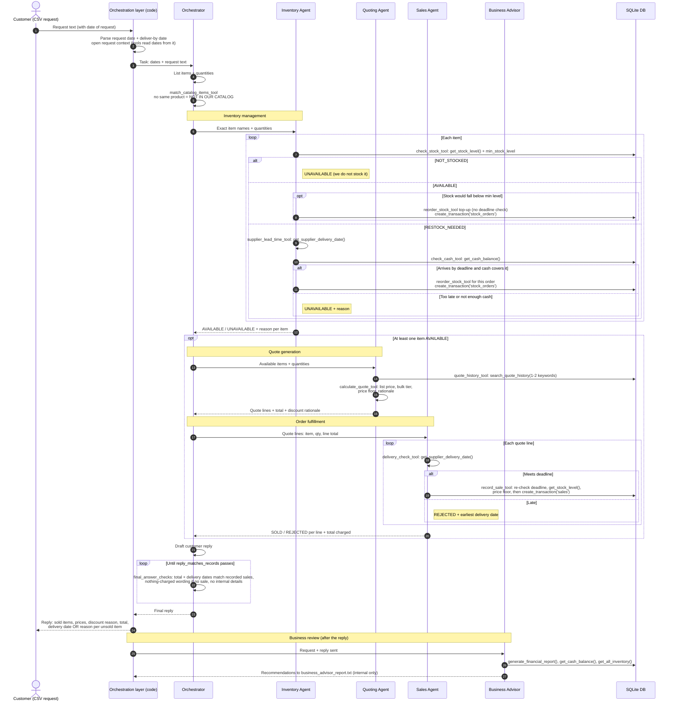

# Agent Workflow

Beaver's Choice Paper Company — multi-agent quoting, inventory and
fulfillment system.

**Agent count: 5 of max 5** (1 orchestrator + 4 workers). The customer is
not an agent: each request is a row from `quote_requests_sample.csv` passed
in by the test harness through `call_your_multi_agent_system()`.

Framework: **smolagents** (`ToolCallingAgent` + `@tool`, model `gpt-5-mini`).
Diagrams and tables describe the implementation used for the final
evaluation run; see [[Starter Code Review]] for notes on each helper.

Around the agents sits a thin **orchestration layer** in code
(`call_your_multi_agent_system`). It parses the request and deliver-by dates,
opens a per-request context that the database tools read, runs the
Orchestrator, and then hands the outcome to the Business Advisor.

| Agent | Sole responsibility | Does NOT do |
| :--- | :--- | :--- |
| **Orchestrator** | Lists the items and quantities, maps them to exact catalog names, delegates to Inventory, Quoting and Sales in order, writes the customer reply (which must pass the `reply_matches_records` check) | Touch the database (its only tool reads the in-code catalog) or parse dates (done in code) |
| **Inventory Agent** | Decides whether each item can be supplied; restocks for an order when the delivery arrives in time and cash allows; tops stock back up to `min_stock_level`; declines items the company does not stock | Price anything or record sales |
| **Quoting Agent** | Prices the request using catalog prices + quote history; applies bulk discounts without going below a price floor | Change stock or cash |
| **Sales Agent** | Checks each line's delivery deadline, records the sale (the tool re-checks deadline, stock and price floor) or rejects the line with a reason | Decide prices or reorders |
| **Business Advisor Agent** | Read-only analyst run by the orchestration layer after each reply and at the end of the run: reviews cash, stock health and the request outcome; recommends operational changes | Write to the DB, talk to the customer, or affect the reply |

## 1. Architecture — agents, tools and helper functions

Rendered copy: `Agent Workflow.svg` (sequence: `Agent Workflow Sequence.svg`).

```mermaid
flowchart TB
    CA(["Customer request<br/>row from quote_requests_sample.csv<br/>(test harness, not an agent)"])
    CTX[["Orchestration layer: call_your_multi_agent_system()<br/>parses request date + deliver-by date in code<br/>request context: dates, item status, recorded sales"]]

    subgraph SYS["Beaver's Choice multi-agent system (5 agents, smolagents)"]
        direction TB
        subgraph ORCH["Orchestrator Agent"]
            direction LR
            O["List items + quantities<br/>Delegate to workers in order<br/>Compose customer reply"]
            OT1["match_catalog_items_tool<br/>Map wording to exact item names<br/>TF-IDF over paper_supplies (no DB helper)"]
            CHK{{"reply_matches_records<br/>(final_answer_checks)<br/>total + delivery dates match records,<br/>'nothing charged' if no sale,<br/>no internal details"}}
            O --- OT1
            O --- CHK
        end

        subgraph INV["Inventory Agent"]
            direction TB
            I["Stock checks and<br/>reorder decisions"]
            IT1["check_stock_tool<br/>AVAILABLE / RESTOCK_NEEDED / NOT_STOCKED<br/>get_stock_level() + min_stock_level"]
            IT2["inventory_snapshot_tool<br/>All in-stock items<br/>get_all_inventory()"]
            IT3["check_cash_tool<br/>Can we afford a reorder?<br/>get_cash_balance()"]
            IT4["supplier_lead_time_tool<br/>Restock arrival vs deadline<br/>get_supplier_delivery_date()"]
            IT5["reorder_stock_tool<br/>Order restock: refuses if over cash<br/>or (customer order) arrives late<br/>Top-up: no deadline check<br/>create_transaction('stock_orders')"]
            I --- IT1 & IT2 & IT3 & IT4 & IT5
        end

        subgraph QUO["Quoting Agent"]
            direction TB
            Q["Pricing and<br/>bulk discounts"]
            QT1["quote_history_tool<br/>Similar past quotes<br/>search_quote_history()"]
            QT2["price_lookup_tool<br/>List price per unit<br/>paper_supplies list (no DB helper)"]
            QT3["calculate_quote_tool<br/>Line totals, discount tier, price floor<br/>pure Python (no DB helper)"]
            Q --- QT1 & QT2 & QT3
        end

        subgraph SAL["Sales Agent"]
            direction TB
            S["Finalize or<br/>reject each line"]
            ST1["delivery_check_tool<br/>Can we meet the deliver-by date?<br/>get_supplier_delivery_date()"]
            ST2["record_sale_tool<br/>Re-checks deadline, stock, price floor<br/>get_supplier_delivery_date() +<br/>get_stock_level() +<br/>create_transaction('sales')"]
            S --- ST1 & ST2
        end

        subgraph ADV["Business Advisor Agent (read-only, runs after the reply)"]
            direction TB
            A["Review outcome,<br/>recommend changes"]
            AT1["financial_report_tool<br/>Cash, inventory value, top sellers<br/>generate_financial_report()"]
            AT2["cash_trend_tool<br/>Cash before vs after<br/>get_cash_balance()"]
            AT3["stock_health_tool<br/>Below-min / out-of-stock items<br/>get_all_inventory()"]
            A --- AT1 & AT2 & AT3
        end
    end

    DB[("SQLite DB: inventory, transactions, quotes, quote_requests")]
    RPT[/"business_advisor_report.txt<br/>(internal only)"/]
    UI[["Terminal progress display<br/>(status events from all agents, not an agent)"]]

    CA -->|"request text"| CTX
    CTX -->|"task: dates + request"| O
    O -->|"final reply (after check passes):<br/>sold items, prices, discount reason, total,<br/>delivery date OR reason per unsold item"| CA

    O <-->|"1. exact item name + qty /<br/>AVAILABLE or UNAVAILABLE + reason"| I
    O <-->|"2. available items + qty /<br/>quote lines, discount, rationale"| Q
    O <-->|"3. item + qty + line total /<br/>SOLD or REJECTED + delivery or reason"| S

    CTX -->|"4. after the reply:<br/>request + reply"| A
    A -->|"internal recommendations"| RPT

    INV <-->|"read / write"| DB
    QUO -->|"read quote history"| DB
    SAL <-->|"read / write"| DB
    ADV -->|"read only"| DB

    SYS -.->|"status events"| UI
```

## 2. Sequence — one customer request end to end

## 3. Standout features (rubric "Make Your Project Stand Out")

Two of the three suggestions are built in. The negotiating Customer Agent
is left out because it would be a 6th agent and break the 5-agent limit.

### 3.1 Terminal animation of request processing

- Not an agent — a display layer (`ProgressDisplay`, a `rich` console status
  spinner) fed by **status events** from every tool and hand-off, e.g.
  `Orchestrator: delegating to Inventory Agent`,
  `Inventory Agent: checking stock of A4 paper x200`,
  `Quoting Agent: pricing 10,500 units, bulk discount 15%`,
  `Sales Agent: sold 200 x Glossy paper for $50.00`.
- Each event is printed as a timeline line marked → (hand-off), • (step),
  ✔ (success) or ✘ (refused or failed), and the spinner shows the latest
  event. A rejected reply appears as
  `Orchestrator: reply did not match the records - rewriting`.
- Cash and inventory value before and after each request are printed by the
  test harness, not by the display.

### 3.2 Business Advisor Agent

- 5th system agent, **read-only** (no `create_transaction`), so its
  responsibility never overlaps with Inventory or Sales.
- Run by the orchestration layer **after** the customer reply, for every
  request and once at the end of the run. Looks at:
  - cash trend (`cash_trend_tool` → `get_cash_balance`),
  - items below minimum or out of stock (`stock_health_tool` →
    `get_all_inventory`),
  - cash, inventory value and top sellers (`financial_report_tool` →
    `generate_financial_report`),
  - the request and the reply sent, including reasons for unsold lines.
- Outputs **internal** recommendations to `business_advisor_report.txt`,
  never to the customer. Example from the evaluation run: *"Raise reorder
  thresholds for A4 paper (highest unit demand: 10,250 units)"*.

## Tool reference (as implemented in Step 4)

Inventory and Sales tools take **no date arguments**: the request date and the
customer's deliver-by date are parsed from the request text in code and held in
a per-request context. In testing, the LLM dropped or invented dates (e.g.
2023-10-03), which made stock and cash read as zero. Advisor tools still take
explicit `YYYY-MM-DD` dates because they compare periods.

| Agent | Tool (signature) | Helper function(s) | Returns / behaviour |
| :--- | :--- | :--- | :--- |
| Orchestrator | `match_catalog_items_tool(item_descriptions: list[str])` | none — TF-IDF match over `paper_supplies` | Top 3 exact catalog names + scores per description; the Orchestrator picks the same product or declines it as not in the catalog |
| Inventory | `check_stock_tool(item_name, quantity_requested)` | `get_stock_level` + `min_stock_level` from `inventory` table | `status` AVAILABLE / RESTOCK_NEEDED / NOT_STOCKED, stock, min level, `needs_reorder`, `suggested_reorder_quantity` |
| Inventory | `inventory_snapshot_tool()` | `get_all_inventory` | `{item: stock}` for items with stock > 0; health check before large orders |
| Inventory | `check_cash_tool()` | `get_cash_balance` | Cash available for a reorder |
| Inventory | `supplier_lead_time_tool(quantity)` | `get_supplier_delivery_date` | Restock arrival date and `arrives_in_time` vs the deliver-by date |
| Inventory | `reorder_stock_tool(item_name, quantity, for_customer_order)` | `create_transaction('stock_orders')` (+ `get_cash_balance`, `get_supplier_delivery_date` guards) | Buys at `quantity × unit_price`; refuses unstocked items, purchases above cash, and customer restocks arriving after the deadline |
| Quoting | `quote_history_tool(search_terms: list[str])` | `search_quote_history` | Up to 5 similar past quotes; 1–2 keywords because terms are ANDed |
| Quoting | `price_lookup_tool(item_names: list[str])` | none — reads `paper_supplies` | List price per unit (cost + 25% markup), or closest exact names |
| Quoting | `calculate_quote_tool(item_names, quantities)` | none — pure Python | Line totals, bulk tier (0% under 1,000 units; 5% 1,000–4,999; 10% 5,000–9,999; 15% 10,000+), price floor (cost + 5%), total, rationale |
| Sales | `delivery_check_tool(quantity)` | `get_supplier_delivery_date` | Estimated delivery date and `meets_deadline` |
| Sales | `record_sale_tool(item_name, quantity, line_total)` | `get_stock_level` + `get_supplier_delivery_date` (guards) + `create_transaction('sales')` | Records the sale; refuses late, short-stock or below-floor lines |
| Advisor | `financial_report_tool(as_of_date)` | `generate_financial_report` | Cash, inventory value, total assets, top sellers |
| Advisor | `cash_trend_tool(before_date, after_date)` | `get_cash_balance` | Cash change across a request |
| Advisor | `stock_health_tool(as_of_date)` | `get_all_inventory` | Items below min level or out of stock |

## Guardrails added during implementation

Problems seen in live test runs, and the code-level fixes:

| Problem seen | Guardrail |
| :--- | :--- |
| Agents dropped or invented dates | Dates parsed in code; DB tools take no dates |
| Customer wording sent instead of catalog names | Tools reject non-catalog names and list the closest exact names |
| Sale recorded after its own delivery check failed | `record_sale_tool` re-checks the deadline itself |
| Orchestrator skipped the Sales Agent, then claimed a charge | `final_answer_checks`: available items must reach the Sales Agent |
| Reply total or delivery dates differed from the DB | Same check: reply must state the recorded total and delivery dates, or say nothing was charged |
| Replies leaked stock counts, supplier, transaction ids | Same check rejects internal-detail phrases; the agent rewrites |
| Repeated delegation could double-book | Sales and customer reorders are idempotent within a request |
| Parallel tool calls could race on SQLite | `max_tool_threads=1` on every agent |

The Business Advisor runs after the Orchestrator has replied (called by the
orchestration layer in `call_your_multi_agent_system`), so its internal notes
go only to `business_advisor_report.txt` and can never leak into a reply.

## Helper function coverage (required by rubric)

| Helper function | Tool | Agent |
| :--- | :--- | :--- |
| `get_stock_level` | check_stock_tool; record_sale_tool (stock guard) | Inventory; Sales |
| `get_all_inventory` | inventory_snapshot_tool; stock_health_tool | Inventory; Business Advisor |
| `get_cash_balance` | check_cash_tool, reorder_stock_tool (cash guard); cash_trend_tool | Inventory; Business Advisor |
| `get_supplier_delivery_date` | supplier_lead_time_tool, reorder_stock_tool (deadline guard); delivery_check_tool, record_sale_tool (deadline guard) | Inventory; Sales |
| `create_transaction` | reorder_stock_tool (`stock_orders`); record_sale_tool (`sales`) | Inventory; Sales |
| `search_quote_history` | quote_history_tool | Quoting |
| `generate_financial_report` | financial_report_tool | Business Advisor |
